 

---

## 👨‍💻 About Me

- 🔭 I'm currently working on **a vehicle tracking system** (web + mobile)
- 🌱 I'm learning **new frameworks and cloud technologies**
- 👯 I'm looking to collaborate on **open-source projects**
- 💬 Ask me about **web development, mobile apps, and databases**
- ⚡ Fun fact: **I turn coffee into code ☕**

  

---

## 🛠️ Tech Stack

---

## 📊 GitHub Stats

 

---

## 🏆 Achievements

---

## 📌 Featured Projects

### 🚗 Vehicle Tracking System

A web and mobile platform that lets vehicle owners monitor all their vehicles in one place, with live maps and smart alerts.

🚧 More projects coming soon...

---

## 🤝 Connect With Me

---

